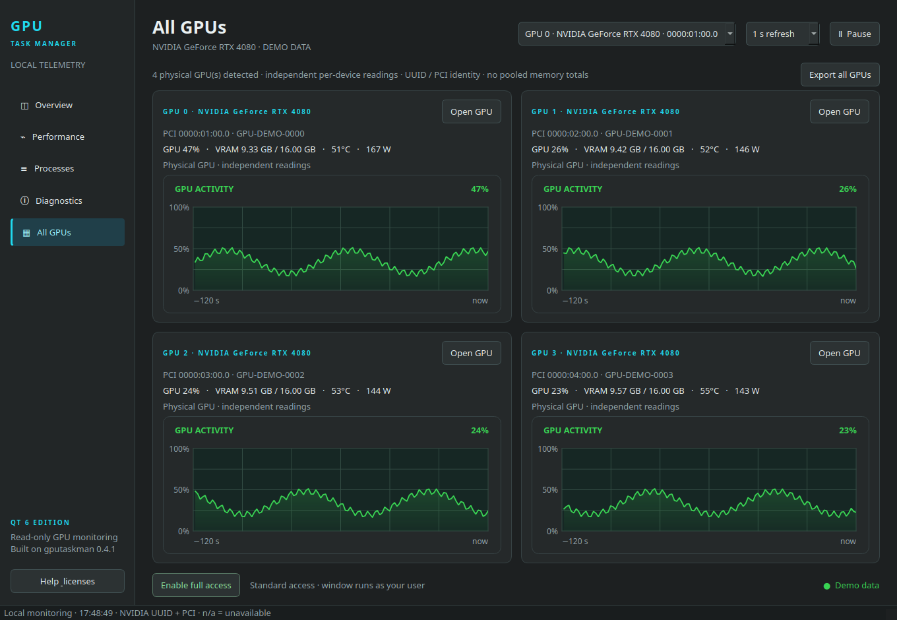

# GPU Task Manager · Qt 6

A native, MIT-licensed Linux GPU monitor built on Scott Hanselman's
[gputaskman](https://github.com/shanselman/gputaskman) 0.4.3 collector.
Uses PySide6 with an original dark interface, clear charts and independent GPU views.

**Primary targets: Debian 13.7 and Ubuntu 26.04, amd64.** Linux Mint 22.3 and
Ubuntu 24.04 remain secondary compatibility targets. No Windows/macOS support
is claimed for this frontend.



## Install

Download the DEB and `SHA256SUMS` from the
[GitHub release](https://github.com/nojan01/gputaskman-qt6/releases/tag/v0.4.3).
Close the previous GUI instance, then install:

```sh
sudo apt install ./gputaskman-qt6_0.4.3-1_amd64.deb
```

Launch **GPU Task Manager (Qt 6)** in the application menu or run `gputaskman-qt6`.
The GUI carries a minimal PySide6/Qt 6.8.3 + Python runtime, so no PyQt6 or pip
installation on the target system is required. Normal desktop libraries come
from apt. The existing TUI package is not changed or replaced.

At startup, Polkit requests administrator authentication for the **collector
only**. The window stays under your user. Cancelling continues with standard
access. Use `gputaskman-qt6 --standard-access` to skip that request. A graphical
Polkit agent is required for the password dialog. Root shells need no further
authentication. No kernel security settings or drivers are modified.

## Views and controls

- **Overview:** device metrics, GPU + temperature history, GPU memory, system RAM/CPU.
- **Performance:** eight histories or one full-width chart; click a chart to focus it.
- **Processes:** sort/search GPU processes, inspect model evidence, export a snapshot.
- **Diagnostics:** source, driver/backend, stable identities and missing counters.
- **All GPUs:** independent device histories and metrics, offline cards, fleet export.
- **Space:** pause; **Ctrl+R:** reconnect; **Ctrl+P:** processes; **F1:** help.
- Refresh rates: 0.5, 1, 2 and 5 seconds. Changes are sent to the running collector,
  without another password prompt, history reset or loss of pause state.

Charts show the trailing 120 seconds. At 1024×768 / 100% scaling, content can be
scrolled; footer controls remain reachable. Demo previews are explicitly labeled:

```sh
gputaskman-qt6 --demo --demo-gpus 4
```

Demo data is never used in normal startup mode.

## Multiple GPUs

Cards are matched using PCI-verified NVIDIA UUIDs, falling back to verified full
PCI addresses (including the domain). Serial numbers are supplemental only.
No matching by model name is performed. Application GPU numbers can differ from
NVML / `nvidia-smi` indices; the latter are shown in diagnostics/tooltips.

All detected physical GPUs are sampled in one persistent collector process,
without a fixed four-card limit. Selection changes only the view and preserves
separate histories. Inventory is checked every five seconds. Offline cards stay
identifiable, and UUID changes at the same PCI slot create a new device.
PCI-only identity follows the slot, not a replaceable physical card. Unknown
stable identities are explicitly marked session-only.

Individual errors do not stop healthy peers. Expensive NVML telemetry is limited
to each collector's PCI-verified device; inspection budgets are divided across
cards. CPU/RAM is sampled once per frame. Samples are sequential, not a
hardware-synchronized snapshot. Catastrophic driver faults can still require a
reconnect. Separate MIG-instance monitoring is not implemented.

## Interpreting measurements

Unknown is **n/a**, not zero; missing readings are chart gaps. System RAM is
OS-reported and must not be added to GPU memory. NVIDIA Memory activity describes
memory activity, not the fraction of VRAM allocated.

Intel memory can be a visible-client sum, with a PCI-window estimate for capacity;
this is not a complete device-wide measured total. When capacity is unknown,
charts show absolute MB/GB instead of an invalid percentage. An adaptive byte
axis is not a capacity estimate. Intel temperature can be the labeled CPU-package
fallback. Extra privileges cannot create counters the driver does not expose.

Process details preserve measured/inferred/runtime-reported distinctions. Model
files and buffer logs can span GPUs; they do not prove per-device placement.
Exports can contain local paths, model names and hardware identifiers. There is
no added telemetry, process-memory dumping, inference request or process-control action.

## Licenses

Application GUI, collector integration, tests, packaging and original icon:
**MIT**, Copyright (c) 2026 Norbert Jander. Original gputaskman code remains
**MIT**, Copyright (c) 2026 Scott Hanselman; its notice is preserved.

Qt/PySide/Shiboken, Python, ICU and other dependencies retain their own licenses.
**The MIT license does not relicense the runtime libraries.** LGPL texts, original
notices, corresponding source archives and library-replacement instructions are
provided. See [THIRD_PARTY.md](gputaskman-qt6/THIRD_PARTY.md). No GPL-only optional Qt modules
or PyQt6 are bundled.

## Build and test

Use an amd64 Ubuntu 24.04 / Mint 22.3 build host with Python 3.12, `binutils`,
`dpkg`, development desktop libraries and the system runtime dependencies listed
in `build_deb.py`. The repository keeps the MIT upstream source separately.

```sh
cd gputaskman-qt6
python3 -m venv /tmp/gputaskman-build-env
/tmp/gputaskman-build-env/bin/pip install -r collector-requirements.txt -r gui-requirements.txt
/tmp/gputaskman-build-env/bin/pip install -e ../gputaskman-source
QT_QPA_PLATFORM=offscreen /tmp/gputaskman-build-env/bin/python -m unittest discover -s . -p 'test_*.py'
/tmp/gputaskman-build-env/bin/pyinstaller --noconfirm --clean worker.spec
/tmp/gputaskman-build-env/bin/pyinstaller --noconfirm --clean gui.spec
python3 build_deb.py
```

Official library sources and hashes are listed in `third-party/sources.json`.
Redistributors must preserve notices and equivalent source access. The GUI spec
keeps selected LGPL Qt modules/plugins and shared ICU, leaving standard desktop
libraries as distribution dependencies. Check ELF requirements when changing
build environments.

## Validation limits

See the release validation report. Tests with 4, 8 and 16 identical NVIDIA cards
are simulations; no physical multi-NVIDIA server has been validated. Container
GUI tests do not validate every real driver, native desktop session or iLO
latency/compression. Report hardware, driver, PCI/UUID identification, expected
behavior and observed behavior when reporting a GPU-specific problem.

The checked-in [CI template](docs/ci-workflow.yml) is ready for GitHub Actions;
workflow activation requires workflow-write permission. See [CI status](docs/CI.md).

## Version numbering

Qt releases follow the integrated upstream collector version (currently 0.4.3). Debian package revisions (`0.4.3-1`, `0.4.3-2`, ...) identify integration fixes using the same collector. This does not imply that the Qt interface implements every upstream terminal command.
